# Validation

Validation of the scoring model against existing data, before calibration with our own find log. Scripts: `validation/` (see `validation/README.md`). Proposed changes are listed per part and are only applied after approval. Changes 1–6 of Part A were approved and applied on 2026-10-20 (details in [SCORING.md](SCORING.md)); Part B uses the updated parameters.

## Part A – Occurrence data (2026-10-20)

### Data

Source: [GBIF](https://www.gbif.org) occurrence search API, the 9 species (Armillaria and Morchella as genera), queried on 2026-10-20.

| Dataset                                    | Licence        | Used for                                                                      |
| ------------------------------------------ | -------------- | ----------------------------------------------------------------------------- |
| Swiss National Fungi Databank (SwissFungi) | CC BY 4.0      | Season shape, coarse habitat check (positions generalised to 5 km, see below) |
| iNaturalist research-grade observations    | CC BY-NC 4.0   | All tests (most precise records)                                              |
| Observation.org                            | CC BY-NC 4.0   | All tests                                                                     |
| NABU naturgucker, and 2 small datasets     | CC BY 4.0, CC0 | All tests                                                                     |
| Global Spore Sampling Project              | CC BY 4.0      | **Excluded:** airborne fungal DNA, not fruiting bodies                        |

The non-commercial (NC) licences are fine for this non-commercial project. For a publication, a GBIF download with a DOI should be created and cited.

**Filters** (ZH + SZ, canton polygons from swissBOUNDARIES3D): present, valid coordinates, a single-day date, location accuracy ≤ 1 km, and duplicates removed (same species, same day, within ~100 m).

| Species            | In the ZH + SZ box | Outside ZH/SZ | No day date | Accuracy > 1 km | Duplicates / not fruiting body | **Kept (strict)** | of which accuracy unknown |
| ------------------ | ------------------ | ------------- | ----------- | --------------- | ------------------------------ | ----------------- | ------------------------- |
| Chanterelle        | 338                | 70            | 0           | 267             | 0                              | **1**             | 1                         |
| Porcini            | 420                | 98            | 0           | 318             | 0                              | **4**             | 2                         |
| Winter chanterelle | 287                | 72            | 0           | 206             | 0                              | **9**             | 7                         |
| Horn of plenty     | 290                | 37            | 1           | 246             | 1                              | **5**             | 3                         |
| Bay bolete         | 597                | 143           | 0           | 443             | 0                              | **11**            | 5                         |
| Hedgehog           | 476                | 103           | 0           | 368             | 0                              | **5**             | 3                         |
| Honey fungus       | 303                | 78            | 0           | 149             | 26                             | **50**            | 17                        |
| Parasol            | 271                | 97            | 0           | 153             | 1                              | **20**            | 4                         |
| Morel              | 370                | 62            | 0           | 298             | 0                              | **10**            | 2                         |

**The main limitation:** almost all records are SwissFungi, and SwissFungi publishes on GBIF "generalized to 5 km grid squares" (accuracy 3,535 m = half the diagonal). Its note says the elevation is the raw value, but the elevation field is empty in all 3,143 records. Only **115 precise records** remain in ZH + SZ, mostly iNaturalist.

So that the tests have some power, two supplements are used, always labelled:

- **CH, precise:** records from all of Switzerland with known accuracy ≤ 1 km (979, 836 since 2021), elevation from swissALTI3D. Used for the season and weather tests, which don't need our grid.
- **SwissFungi 5 km:** 2,428 records in ZH + SZ with exact dates but 5 km positions. Used for the season shape (all elevations pooled) and a coarse habitat check.

### Habitat test

For each species, the habitat score H (with drought factor 1) of the forest squares containing a record is compared with all forest squares (AUC: probability that a record square scores higher than a random forest square; 0.5 = no signal) and with a "target group" background: squares with a record of any of the 9 species, which partly corrects for where observers go.

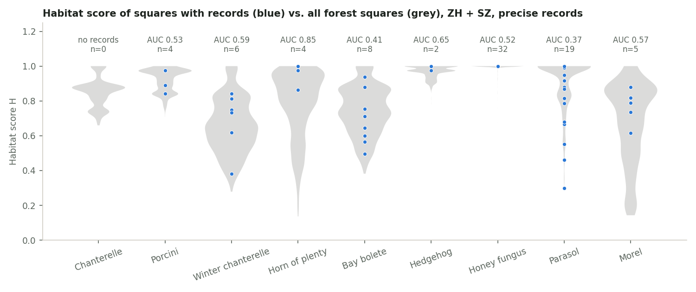

| Species            | Squares with records | AUC vs all forest squares (95 % CI) | AUC vs target group | SwissFungi 5 km: squares, AUC |
| ------------------ | -------------------- | ----------------------------------- | ------------------- | ----------------------------- |
| Chanterelle        | 0                    | –                                   | –                   | 41, 0.61                      |
| Porcini            | 4                    | 0.53 (0.24–0.82)                    | 0.50                | 54, 0.50                      |
| Winter chanterelle | 6                    | 0.59 (0.34–0.78)                    | 0.62                | 40, 0.62                      |
| Horn of plenty     | 4                    | 0.85 (0.65–0.98)                    | 0.79                | 40, 0.58                      |
| Bay bolete         | 8                    | 0.41 (0.23–0.64)                    | 0.45                | 53, 0.57                      |
| Hedgehog           | 2                    | 0.65                                | 0.53                | 58, 0.50                      |
| Honey fungus       | 32                   | 0.52                                | 0.51                | 40, 0.53                      |
| Parasol            | 19                   | 0.37 (0.25–0.50)                    | 0.43                | 45, 0.50                      |
| Morel              | 5                    | 0.57 (0.43–0.71)                    | 0.47                | 48, 0.56                      |

- **Matches:** horn of plenty (beech, calcareous) scores higher where it was found (0.85, n = 4); winter chanterelle and chanterelle point the right way on the 5 km squares (0.62, 0.61).
- **Doesn't match:** parasol (0.37) – its records are in squares with _more_ tree cover than the model's 20–60 % preference (the forest-cover part alone: AUC 0.31). Bay bolete (0.41) – record squares have a median of 33 % conifers, the model wants 50–100 % (host part: AUC 0.35).
- **Not testable:** honey fungus (the model gives almost every square the same H, by design). Most other species have too few precise records for a conclusion: the confidence intervals include 0.5.
- On 5 km squares H is averaged over 25 squares, which washes out differences; AUCs near 0.5 there are expected and say little.

### Season test

Record dates against the model's season (start–end) and peak, by elevation. Strict ZH + SZ records: 82–100 % fall inside the season, but n = 1–50. The tables and charts use the CH-precise supplement.

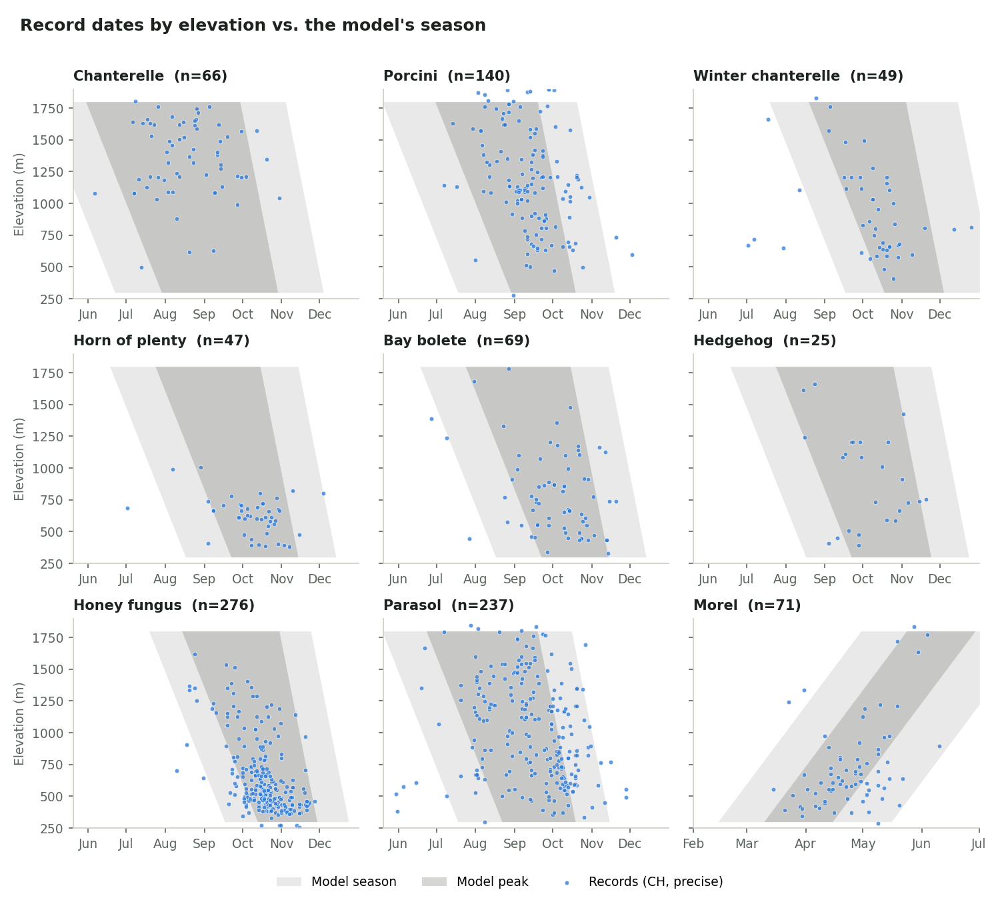

| Species            | Records (CH, precise) | In model season | In model peak | Elevation shift: records vs model (days per 100 m) |
| ------------------ | --------------------- | --------------- | ------------- | -------------------------------------------------- |
| Chanterelle        | 66                    | 98 %            | 91 %          | +0.3 vs start −4 / end −2                          |
| Porcini            | 140                   | 99 %            | 79 %          | −2.3 vs start −4 / end −2                          |
| Winter chanterelle | 49                    | 88 %            | 78 %          | −3.2 vs start −4 / end −2                          |
| Horn of plenty     | 47                    | 94 %            | 83 %          | −6.3 vs start −4 / end −2                          |
| Bay bolete         | 69                    | 96 %            | 80 %          | −2.1 vs start −4 / end −2                          |
| Hedgehog           | 25                    | 100 %           | 84 %          | −2.4 vs start −4 / end −2                          |
| Honey fungus       | 276                   | 99 %            | 89 %          | −3.4 vs start −4 / end −2                          |
| Parasol            | 237                   | 96 %            | 68 %          | −2.3 vs start −4 / end −2                          |
| Morel              | 71                    | 97 %            | 70 %          | +2.5 vs start +5 / end +5                          |

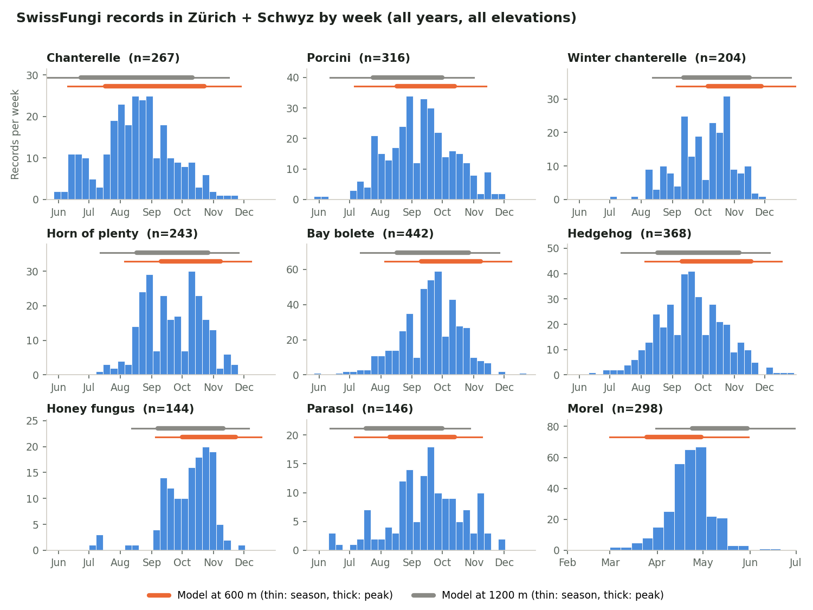

- **Matches:** almost all records fall inside the model's season; porcini, bay bolete, hedgehog and honey fungus follow the model's peak and its "earlier higher up" shift (about −2 to −3.5 days per 100 m, between the model's start and end shifts).
- **Doesn't match:**
  - **Parasol** peaks later than the model: records run from mid-August to the end of October at all elevations (median date 2–4 weeks after the model's peak midpoint); only 68 % fall in the peak.
  - **Morel:** at low elevations the records peak in mid-April to early May, the model's peak is late March to late April (about 2–3 weeks early). The elevation shift in the records (+2.5 days per 100 m) is about half the model's +5.
  - **Chanterelle:** no earlier fruiting higher up in the records (+0.3 vs −4/−2). SwissFungi also shows an early wave in June–July.
  - **Winter chanterelle:** SwissFungi records start in August; in the lowlands the model's season only starts in early September (12 % of CH records fall before it).
- **Limits:** observers are out more in September–October and at weekends, which shapes the date distribution; the elevation slopes are less affected. Seasons are wide, so "in season" is a lenient test; the peak and the slopes are the informative parts.

### Weather test (case-control)

For each CH-precise record since 2021 (836): the weather part of the score, W = M0.6 × T0.4 × F × D (no season, no habitat), on the record date vs. control dates at the same place (3 km weather block, the record's elevation), ±30 days in the same year, excluding ±5 days around the record, and only on the same kind of day (weekend vs weekday). Result per record: the percentile of the record date among its controls; 0.5 = no signal.

**Observer bias:** people go out (and post photos) when the weather is pleasant, at weekends, and often _because_ it rained a week before. Weekday matching handles the weekend effect. For the rest, a **placebo** is scored the same way: three bracket fungi that sit on trees all year (tinder fungus _Fomes fomentarius_, red-belted conk _Fomitopsis pinicola_, artist's conk _Ganoderma applanatum_; up to 300 CH-precise records since 2021, March–November), so their record dates only reflect when observers are out. Each species is compared with the placebo records from its own months (morel: spring). Weather: Open-Meteo historical forecast (best match), 648 place-year windows, 5,890 weighted API calls.

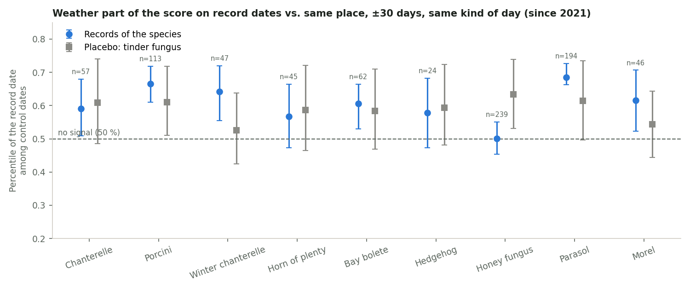

| Species            | Records | Percentile of W on record dates (95 % CI) | Placebo (bracket fungi, same months) | Difference |
| ------------------ | ------- | ----------------------------------------- | ------------------------------------ | ---------- |
| Chanterelle        | 57      | 0.59 (0.51–0.68)                          | 0.52 (0.47–0.56), n = 168            | +0.07      |
| Porcini            | 113     | 0.67 (0.61–0.72)                          | 0.51 (0.47–0.56), n = 168            | +0.16      |
| Winter chanterelle | 47      | 0.64 (0.56–0.72)                          | 0.52 (0.48–0.56), n = 168            | +0.12      |
| Horn of plenty     | 45      | 0.57 (0.47–0.66)                          | 0.53 (0.49–0.57), n = 168            | +0.04      |
| Bay bolete         | 62      | 0.61 (0.53–0.66)                          | 0.53 (0.50–0.58), n = 168            | +0.07      |
| Hedgehog           | 24      | 0.58 (0.47–0.68)                          | 0.53 (0.49–0.57), n = 168            | +0.05      |
| Honey fungus       | 239     | 0.50 (0.45–0.55)                          | 0.53 (0.50–0.58), n = 168            | −0.03      |
| Parasol            | 194     | 0.69 (0.66–0.73)                          | 0.51 (0.47–0.56), n = 168            | +0.17      |
| Morel              | 46      | 0.62 (0.52–0.71)                          | 0.60 (0.54–0.65), n = 95             | +0.02      |

_Placebo updated on 2026-10-20 with three bracket fungi instead of tinder fungus alone (n ≈ 23). The first, small placebo had suggested ~0.6 for all species._

- **Matches:** for porcini, parasol, winter chanterelle, bay bolete and chanterelle, record dates have clearly better weather scores than the control dates (CI above 0.5). For porcini and parasol it's mostly the moisture part (M percentile 0.66–0.67).
- **Observer bias is small in summer and autumn:** the larger placebo scores only 0.51–0.53, so most of the signal above is real. **Parasol (+0.17), porcini (+0.16) and winter chanterelle (+0.12)** clearly beat it; chanterelle and bay bolete (+0.07) somewhat; horn of plenty and hedgehog (+0.04–0.05) barely, with small samples.
- **Doesn't match:** **honey fungus** has no signal at all (0.50, n = 239, the largest sample), slightly below the placebo. Its weather response in the model (rain 5–10 days before, 6–15 °C) doesn't describe when it's recorded. **Morel** (0.62) is no better than the spring placebo (0.60): people go out on nice spring days, and that explains the morel signal.
- **Limits:** record dates are when someone _reported_ a mushroom, not when it fruited; a record says nothing about the days without one; Open-Meteo's weather at 3 km is not the forest floor. This test can show whether the model's weather response points the right way, not how strong it should be.

### Proposed parameter changes (1–6 approved and applied on 2026-10-20, 4 and 5 in a milder form; see SCORING.md)

| #   | Species            | Change                                                                                                                           | Evidence                                    | Confidence |
| --- | ------------------ | -------------------------------------------------------------------------------------------------------------------------------- | ------------------------------------------- | ---------- |
| 1   | Parasol            | Season later: peakStart 07-25 → 08-10, peakEnd 10-05 → 10-25, end 11-01 → 11-20                                                  | Season test, 237 records, peak share 68 %   | Medium     |
| 2   | Parasol            | Tree-cover preference 20–60 % → 20–100 % (or weight 0.35 → 0.15): edges can't be seen at 1 km                                    | Habitat AUC 0.37, forest part 0.31 (n = 19) | Low–medium |
| 3   | Morel              | Season ~2 weeks later: peakStart 03-25 → 04-08, peakEnd 04-30 → 05-12, end 05-31 → 06-10; elevation shift +5 → +3 days per 100 m | Season test + SwissFungi (298 records)      | Medium     |
| 4   | Chanterelle        | Elevation shift start −4 → −1, end −2 → 0                                                                                        | Season test, 66 records, slope +0.3         | Low–medium |
| 5   | Winter chanterelle | Season start 08-20 → 08-01; elevation start shift −4 → −2                                                                        | SwissFungi shows records from August        | Low–medium |
| 6   | Bay bolete         | Conifer preference 50–100 % → 20–100 %                                                                                           | Habitat host part AUC 0.35 (n = 8)          | Low        |
| 7   | Honey fungus       | No change yet: look at it in Part B (longer rain lag, e.g. 10–20 days, or the cooling trigger)                                   | Weather test: no signal                     | –          |

**Data improvements:** the larger placebo group is now in place. Only open data are used, so the coarse SwissFungi positions remain a limit.

## Part B – Past seasons (2026-10-20)

### Method

The app's engine with the current parameters recomputed every day from 1 June to 15 November for 2021–2025, and 2026 up to 18 October: the 14 spots and a fixed sample of 30 forest squares (15 ZH, 15 SZ, chosen at random with a fixed seed). Weather: Open-Meteo historical forecast (best match), 4,230 weighted calls, run on GitHub Actions (workflow "Validation (manual)"). The curve shown is the weekly mean of the map score (best of the default favourites).

This was compared with two independent sources:

1. **Documented good and poor periods** from news reports and mushroom-control statistics (table below). They describe Switzerland or the region as a whole and give dates only to within a week or two.
2. **Pilz-Ticker Schweiz** ([passion-pilze-sammeln.com](https://www.passion-pilze-sammeln.com/pilztickerarchiv_schweiz.html)): readers' dated reports, mostly from eastern and central Switzerland. `validation/fetch-ticker.ts` reads the 60 archive pages (robots.txt allows it, 1 s between pages) and keeps only the date of each report and whether it says "nothing / too dry" (keyword match, rough). 210 reports for 2021–2026, 26–43 per year.

### Documented periods

| Year | What was reported                                                                                                                                               | Sources                                                                                                                                                                                                                                                                                                                                                                                                               |
| ---- | --------------------------------------------------------------------------------------------------------------------------------------------------------------- | --------------------------------------------------------------------------------------------------------------------------------------------------------------------------------------------------------------------------------------------------------------------------------------------------------------------------------------------------------------------------------------------------------------------- |
| 2021 | Strong flush late June – early July, then hardly anything until the end of September: a poor year                                                               | [Aargauer Zeitung, 13 Jan 2022](https://www.aargauerzeitung.ch/aargau/wyna-suhre/aargau-west-von-drogenpilzli-und-falschen-champignons-so-war-die-pilz-saison-2021-ld.2237720)                                                                                                                                                                                                                                        |
| 2022 | Hot, dry summer; boom from early September; record year (VAPKO: 27,812 controls, 39,354 kg; Zürich: 8,600 control slips)                                        | [SRF, 17 Sep 2022](https://www.srf.ch/news/schweiz/pilzboom-in-der-schweiz-wetterumschwung-laesst-pilze-nun-doch-spriessen), [watson](https://www.watson.ch/schweiz/daten/819199035-pilzsaison-schweiz-so-viele-toedlich-giftige-pilze-wurden-2022-gesammelt)                                                                                                                                                         |
| 2023 | Good porcini in July, hot and dry August, weak year overall (Zürich: ~3,600 control slips, less than half of 2022)                                              | [Kanton Zürich](https://www.zh.ch/de/news-uebersicht/mitteilungen/2024/gesundheit/lebensmittel/pilzkontrollen-im-kanton-zuerich-2023.html), [Tierwelt](https://www.tierwelt.ch/artikel/natur-umwelt/fazit-der-pilzsaison-dieses-jahr-war-ein-schlechtes-pilzjahr-496077)                                                                                                                                              |
| 2024 | Wet summer but a weak late summer; boom in October; productive year                                                                                             | [Dorfblitz](https://dorfblitz.ch/pilzjahr-2024/), [OnlineReports](https://onlinereports.ch/a/pilzsaison-2024-ein-drittel-des-sammelguts-war-giftig-23199)                                                                                                                                                                                                                                                             |
| 2025 | Schwyz region: good start, then it stopped (10 Sep 2025). Local controls mixed: Küsnacht ZH below average, Spreitenbach AG busy until November. Dates uncertain | [Bote der Urschweiz, 10 Sep 2025](https://www.bote.ch/nachrichten/schwyz/guter-start-in-die-pilzsaison-dann-war-schluss-art-1619861), [nau.ch Spreitenbach](https://www.nau.ch/ort/dietikon/pilzsaison-2025-mit-rekordzahlen-bei-kontrollen-67082355), [Pilze unter der Lupe (Küsnacht)](https://goldkueste24.ch/articles/357038-pilze-unter-der-lupe)                                                                |
| 2026 | Drought: summer season practically failed, Zürich forests empty in August; Pilz-Ticker reports a big flush around 6 September; rain again ~8–10 October         | [SRF, 6 Aug 2026](https://www.srf.ch/radio-srf-1/rare-eierschwaemmchen-hitze-bremst-pilzsaison-aus-es-ist-ganz-schitter), [20 Minuten, 14 Aug 2026](https://www.20min.ch/story/pilze-in-der-schweiz-trockenheit-laesst-waelder-fast-leer-zurueck-103615448), [Limmattaler Zeitung, 13 Aug 2026](https://www.limmattalerzeitung.ch/limmattal/zuerich/pilze-im-kanton-zuerich-trockenheit-bremst-die-saison-ld.4216559) |

No official per-season control statistics for Schwyz, or for Zürich after 2023, were found online.

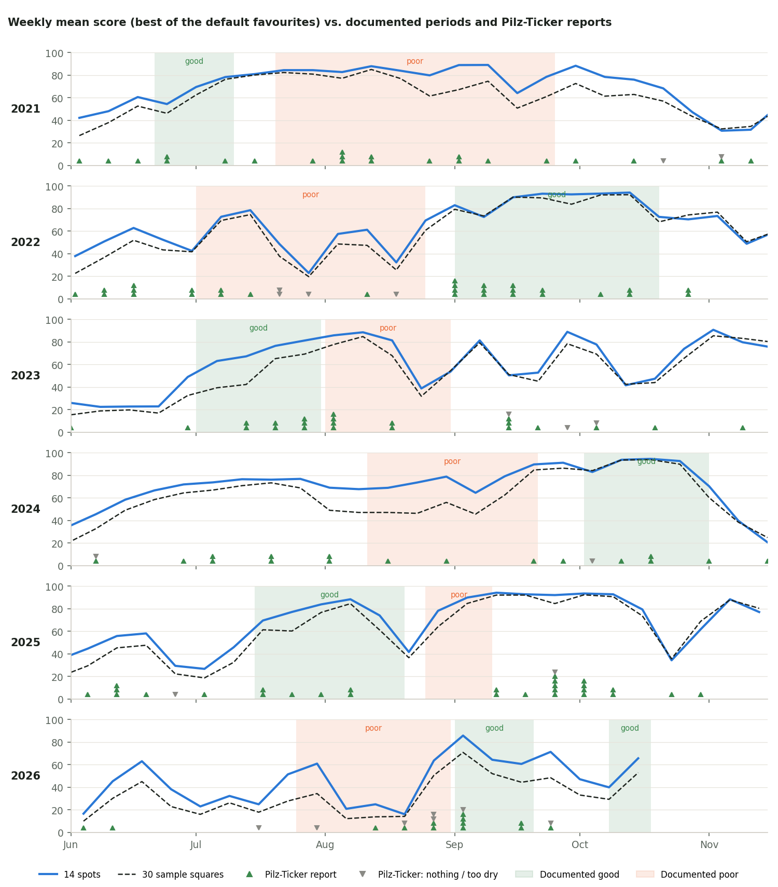

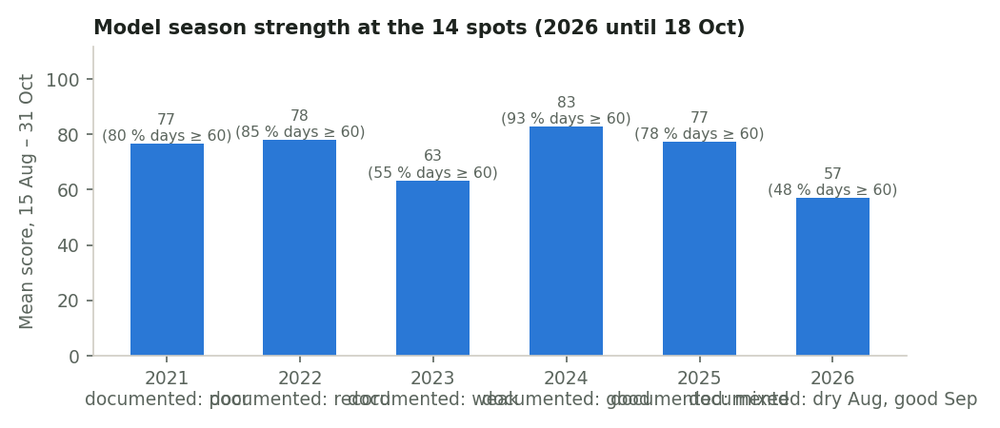

### Results

- **Matches – dry spells:** the model reacts well to drought. 2022: low in late July and mid-August (23–32), then 83–94 from the start of September through mid-October, exactly the documented boom. 2026: 16–25 for most of August, 86 in the week of the 6 September flush, a drop in early October and a rise again after the rain of 8–10 October. 2023: the drop in late August (39) matches the hot, dry end of August.
- **Matches – year ranking (partly):** the model's season strength (mean score 15 Aug – 31 Oct at the spots) puts **2023 (63) and 2026 (57)** clearly lowest, as documented, and **2024 (83)** highest. The October 2024 boom is the model's highest stretch (93–95).
- **Matches – Pilz-Ticker:** weeks with a positive ticker report have a higher model score (mean 67, 83 weeks) than weeks without (62, 53 weeks) and weeks with only "nothing / too dry" reports (51, 9 weeks). The direction is right, but the ticker has only 1–6 reports per week, so it can't say how good a week was.
- **Doesn't match – wet summers:** the model is too optimistic when it rains regularly. **2021** (very wet summer) scores 80–89 from late July to September, when hardly anything was found; it ranks 2021 (77) level with the record year 2022 (78). Late summer **2024** (68–79, documented weak) and the September 2025 pause (78–94) show the same pattern. When it rains every week, the moisture part stays near its maximum and nothing pulls the score down.
- **Doesn't match – early August 2023:** documented hot and dry, the model is still at 85–89 because July was wet; it falls only in the last third of the month.
- **Honey fungus:** the ticker doesn't name species, so Part B can't test it on its own. Note only that the model gives it the highest late-season means of all species (52–73) with little difference between years, which fits the missing weather signal of Part A.
- **Spots vs squares:** the random squares follow the spots week by week, 0–20 points lower (spots were chosen for good habitat), so what is said above holds for the whole grid.
- **Limits:** documented periods are national or regional and roughly dated; good years also mean more people out picking; the ticker is small and mostly from eastern Switzerland; 2025 dates are uncertain.

### Proposed parameter changes (not applied)

| #   | Species      | Change                                                                                                                                                                                                                                   | Evidence                                                                        | Confidence |
| --- | ------------ | ---------------------------------------------------------------------------------------------------------------------------------------------------------------------------------------------------------------------------------------- | ------------------------------------------------------------------------------- | ---------- |
| 1   | All          | Make the moisture part less generous in long wet spells: measure soil moisture against a longer window (soilRangeDays 60 → 120, so a wet summer is no longer "the wettest in 60 days" every week) To be tested in Part C before deciding | 2021, late summer 2024 and Sep 2025 overrated; 2021 ranked like the record 2022 | Low–medium |
| 2   | All          | Optional, more experimental: a "recovery" term, i.e. a flush needs a wet spell after a drier one; continuous rain gives less than rain after a dry week                                                                                  | Same three periods, plus the strong booms after drought in 2022 and 2026        | Low        |
| 3   | Honey fungus | Test in Part C: rain lag 10–20 days instead of 5–10, and the cooling trigger as a requirement (it fruits after the first cold nights in autumn)                                                                                          | Part A: no weather signal; Part B: high every year                              | Low        |
| 4   | –            | No change to the drought response (D factor, rain cap): dry spells are reproduced well                                                                                                                                                   | 2022, 2023, 2026                                                                | Medium     |

Scripts: `validation/past-seasons.ts` (via the manual workflow, ~4,200 Open-Meteo calls), `validation/fetch-ticker.ts`, charts in `validation/plots.py`.

## Part C – Variants and sanity checks (2026-10-20)

### Protocol (written before the variants were run)

**Variants** (parameters fixed in advance, not tuned; implemented in `validation/variants.ts` on top of the engine, without changing `species.json` or `config.ts`):

| ID  | Variant                                                                                                                                                                       |
| --- | ----------------------------------------------------------------------------------------------------------------------------------------------------------------------------- |
| V0  | Current model                                                                                                                                                                 |
| V1  | Proposal 1: soil moisture judged against its range over 120 days instead of 60                                                                                                |
| V2  | Proposal 2, wet after dry: rain in the 21 days before the species' rain window vs. the regional normal; ≤ 0.5 × normal leaves M unchanged, ≥ 1.5 × normal multiplies M by 0.7 |
| V12 | V1 + V2                                                                                                                                                                       |
| T1  | Cool period: T is capped by the temperature score of the 30-day mean (a cool month limits a warm week)                                                                        |
| T2  | Stricter temperature band: the tails outside each species' band halved                                                                                                        |
| H1  | Proposal 3a, honey fungus only: rain window 10–20 days before (now 5–10)                                                                                                      |
| H2  | Proposal 3b, honey fungus only: T halved unless a cooling trigger happened in the last 21 days                                                                                |
| H3  | H1 + H2                                                                                                                                                                       |

**Metrics**, each computed on the training years 2021–2024 and, separately, on 2025–2026:

- **Period AUC:** weekly mean score at the 14 spots (best of the default favourites) in documented good weeks vs documented poor weeks (`validation/data/documented-periods.json`); the probability that a random good week scores higher than a random poor week. 0.5 = no separation. Also on the 30 sample squares.
- **Pilz-Ticker AUC:** weeks with a positive ticker report vs all other weeks (June – mid-November).
- **Year order:** the 4 clearly documented pairs of training years (2022 and 2024 better than 2021 and 2023), counted when the model's season strength (mean 15 Aug – 31 Oct) is in the same order.
- **Weather (Part A):** percentile of the weather part on record dates among control dates, minus the placebo, averaged over the 9 species; records from 2021–2024 for training, 2025–2026 for the check. Honey fungus variants are judged on this metric for honey fungus only (the other metrics don't include it).
- Part A habitat and season tests don't depend on the weather, so the variants don't change them.

**Decision rule:** a variant clearly improves things if, on 2021–2024, the period AUC rises by at least 0.05 and neither the Pilz-Ticker AUC nor the weather metric drops by more than 0.02. Among those, the simplest wins (V1 or T2 before V2 or T1, before combinations). A honey fungus variant clearly improves things if its training weather percentile rises by at least 0.04. If nothing clearly improves, the current model stays. Only then is the chosen variant looked at on 2025–2026.

_Added after the main run, as a check and not chosen by the rule:_ **H1b**, the same as H1 but with honey fungus' full rain scaled with the longer window (30 → 55 mm), so the rain needed per day stays the same. Added because H1 raised the honey fungus score level (see below).

**Data:** past seasons as in Part B, now with weather from 2 January (150 days before 1 June; GitHub Actions, 5,400 calls). Open-Meteo's historical forecast starts on 23 March 2021, so early summer 2021 has less than 120 days of history: the 120-day variants use what exists there, as the app would. The case-control windows got 60 extra days in front (3,400 calls). With the longer history the current model gives exactly the Part B values.

### Results: variants

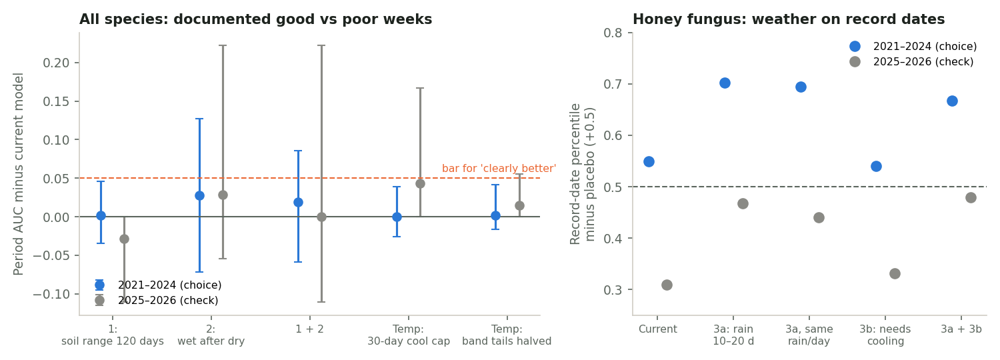

| Variant                     | Period AUC 2021–24 (difference to current, 95 % range) | Period AUC 2025–26 | Pilz-Ticker AUC 21–24 / 25–26 | Weather (Part A) 21–24 / 25–26 | Season strength 2021 / 2022 |
| --------------------------- | ------------------------------------------------------ | ------------------ | ----------------------------- | ------------------------------ | --------------------------- |
| V0 current                  | 0.657                                                  | 0.700              | 0.591 / 0.592                 | 0.604 / 0.535                  | 77 / 78                     |
| V1 soil range 120 days      | 0.659 (+0.002, −0.035 to +0.045)                       | 0.671              | 0.575 / 0.611                 | 0.602 / 0.537                  | 78 / 80                     |
| V2 wet after dry            | 0.684 (+0.027, −0.071 to +0.127)                       | 0.729              | 0.586 / 0.585                 | 0.595 / 0.543                  | 67 / 69                     |
| V12 1 + 2                   | 0.676 (+0.019, −0.059 to +0.086)                       | 0.700              | 0.568 / 0.595                 | 0.594 / 0.552                  | 68 / 71                     |
| T1 30-day cool cap          | 0.657 (0.000, −0.026 to +0.039)                        | 0.743              | 0.592 / 0.593                 | 0.603 / 0.576                  | 76 / 78                     |
| T2 temperature tails halved | 0.659 (+0.002, −0.016 to +0.042)                       | 0.714              | 0.577 / 0.605                 | 0.600 / 0.578                  | 76 / 78                     |

Period AUC on the 30 sample squares (2021–24): 0.710 current, 0.709–0.728 for the variants. All variants keep the documented order of the training years (4 of 4 pairs, as the current model does). The 2025–26 columns are shown for completeness; the choice was made on 2021–2024 only.

| Honey fungus variant       | Weather on record dates, minus placebo, 2021–24 (n = 159) | 2025–26 (n = 80) | Record dates alone, 21–24 / 25–26 | Mean score 15 Aug – 31 Oct at the spots, 2021 / 2022 / 2026 |
| -------------------------- | --------------------------------------------------------- | ---------------- | --------------------------------- | ----------------------------------------------------------- |
| Current (rain 5–10 days)   | 0.549                                                     | 0.309            | 0.565 / 0.370                     | 63 / 72 / 50                                                |
| H1 rain 10–20 days         | **0.703**                                                 | 0.467            | 0.678 / 0.584                     | 72 / 74 / 51                                                |
| H1b rain 10–20 days, 55 mm | **0.695**                                                 | 0.440            | 0.669 / 0.560                     | 68 / 71 / 43                                                |
| H2 needs a cooling trigger | 0.540                                                     | 0.331            | 0.557 / 0.390                     | 63 / 69 / 50                                                |
| H3 H1 + H2                 | 0.668                                                     | 0.479            | 0.648 / 0.594                     | 71 / 71 / 51                                                |

- **Proposals 1 and 2 don't clearly help.** The soil range over 120 days changes nothing (+0.002). Wet after dry is the best of them (+0.027), but below the bar and well within the noise: with only 8 documented periods in 2021–2024 the period AUC itself is uncertain (95 % range 0.28–0.87 for the current model). An earlier run seemed to show +0.055 for V1; that came only from early-summer 2021 weeks being dropped (too little history), not from the variant. Wet after dry also lowers all scores by about 10 points, including the record year 2022, so it doesn't separate 2021 from 2022 either.
- **Temperature is not why 2021 is overrated.** From mid-August to October the temperature part was 0.98 in 2021 and 0.99 in 2022 at the spots, and the moisture part 0.72 in both: in the model's inputs, autumn 2021 looks like autumn 2022. Neither temperature variant changes that (T1, T2: 0.000 and +0.002).
- So the overrating of wet summers stays unexplained by weather. Possible reasons outside the model: the documented "poor 2021" rests on one regional report (Aargau); the July 2021 floods; or effects of the previous years on the mycelium. More documented periods (or our own find log) are needed before changing the moisture model.
- **Honey fungus, proposal 3a works:** with rain 10–20 days before, record dates have clearly better weather than their controls (0.70 vs 0.55 on 2021–24). It also holds on the held-out years: on the record dates alone 0.37 → 0.58. After the placebo is subtracted, 2025–26 is still below 0.5 (0.47 vs 0.31 now), because in those two years the placebo itself scores higher. **3b (the cooling trigger) doesn't help**, alone or combined.
- H1 raises honey fungus scores further (2021: 63 → 72), and honey fungus is already the highest-scoring species. H1b gets the same improvement (0.695 vs 0.703) with the score level close to today's.

### Results: sanity checks

**Monotonicity** (`packages/scoring/test/monotonicity.test.ts`, now part of `npm test`, 99 tests): for every species, from a good base day, more rain in the window, wetter soil and a wetter 60 days never lower the score; more frost nights never raise it; temperature and season each have a single optimum; moving elevation, conifer share or tree cover away from the preferred range never helps; a better pH class never hurts; out of season the score is 0. **All pass.**

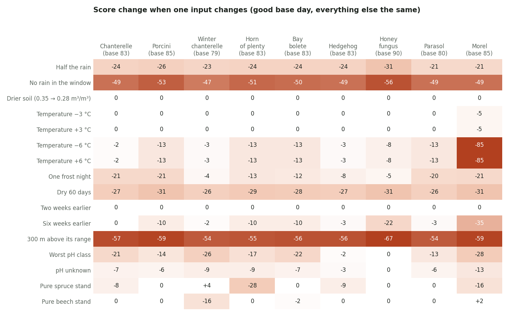

**Sensitivity** (one input changed from a good base day of 80–90; chart and numbers updated on 2026-10-21 with the new honey fungus rain window):

- **Rain dominates:** no rain in the window costs 49–56 points, a third of the rain 21–31, a dry 60 days 26–32. Elevation 300 m above the range costs 54–67. That's the intended order.
- **Temperature barely matters inside the band:** ±3 °C changes nothing for 8 of 9 species (morel −5); ±6 °C costs 2–13 (morel −87, partly through frost). Together with T ≈ 0.98 in every past autumn: in practice the temperature part works only at the edges of the season.
- **Absolute soil moisture doesn't count:** soil moisture is compared with the place's own range over the last 60 days, so 0.28 or 0.35 m³/m³ give the same score if both are the wettest of those 60 days. This is by design (soils differ), and the 120-day variant didn't improve anything.
- **Honey fungus ignores habitat entirely:** pH, conifer share and tree cover change nothing; its habitat score is 1.00 on every square (see map). Its map is weather and elevation only.

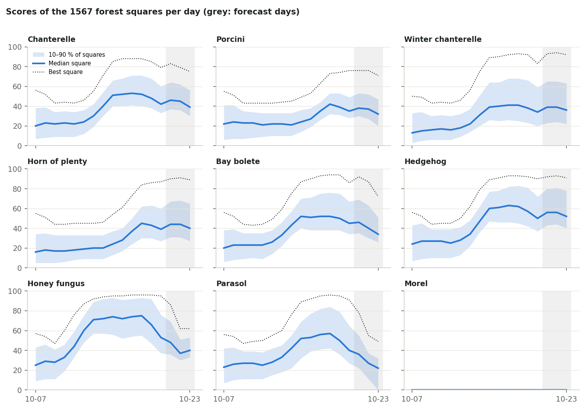

**Score spread across the 1,567 squares** (7–23 Oct 2026, the last 3 days forecast): all species rise together after the rain of 8–10 October (median from 13–25 to 41–75), and the 10–90 % band stays 25–35 points wide, so the map keeps its contrast. Morel is 0 everywhere (out of season, correct). On 20 October honey fungus has the most squares ≥ 60 (42 %), porcini the fewest (1 %), which fits the end of the porcini season.

**Habitat maps**, one per species (H, the habitat part only, no weather). _The map images were redrawn on 2026-10-21 with the host-tree model; the table shows the values before that change (current values: the host-tree section below)._

| Species            | H, 10–90 % of squares | Squares with H ≥ 0.7 | Map                                                  |
| ------------------ | --------------------- | -------------------- | ---------------------------------------------------- |
| Chanterelle        | 0.74–1.00             | 97 %                 | [map](validation/habitat-map-chanterelle.png)        |
| Porcini            | 0.84–0.98             | 100 %                | [map](validation/habitat-map-porcini.png)            |
| Winter chanterelle | 0.45–0.84             | 37 %                 | [map](validation/habitat-map-winter-chanterelle.png) |
| Horn of plenty     | 0.48–0.97             | 73 %                 | [map](validation/habitat-map-horn-of-plenty.png)     |
| Bay bolete         | 0.74–1.00             | 97 %                 | [map](validation/habitat-map-bay-bolete.png)         |
| Hedgehog           | 0.91–1.00             | 100 %                | [map](validation/habitat-map-hedgehog.png)           |
| Honey fungus       | 1.00–1.00             | 100 %                | [map](validation/habitat-map-honey-fungus.png)       |
| Parasol            | 0.83–1.00             | 97 %                 | [map](validation/habitat-map-parasol.png)            |
| Morel              | 0.31–0.88             | 56 %                 | [map](validation/habitat-map-morel.png)              |

For 6 of 9 species almost every forest square counts as good habitat, so the map differences come mostly from weather and elevation. Only winter chanterelle, horn of plenty and morel show real habitat contrast. This fits Part A (habitat AUC around 0.5): the habitat layers at 1 km don't separate find places from other forest, and making them more selective wouldn't be supported by the data.

### Recommendation (not applied)

| #   | Change                                                                                                           | Evidence                                                                                                     | Confidence |
| --- | ---------------------------------------------------------------------------------------------------------------- | ------------------------------------------------------------------------------------------------------------ | ---------- |
| 1   | **Keep the moisture and temperature model as it is.** Proposals 1 and 2 and both temperature variants: no change | No variant passes the bar; differences within noise; the 2021 overrating isn't in the model's weather inputs | Medium     |
| 2   | **Honey fungus: rain window 5–10 → 10–20 days, full rain 30 → 55 mm** (H1b)                                      | Weather on record dates 0.55 → 0.70 (2021–24, n = 159); record dates alone 0.37 → 0.56 on 2025–26            | Medium     |
| 3   | Honey fungus: no cooling trigger requirement                                                                     | 3b: no improvement                                                                                           | Medium     |

For 2, the strict rule would pick H1 (only the window changes). I recommend H1b because it improves things as much without pushing honey fungus, already the highest-scoring species, even higher (in the poor year 2021: 68 instead of 72). Even with the change, honey fungus remains the species with the weakest weather signal.

Scripts: `validation/variants.ts` (no API calls; needs the weather caches from `past-seasons.ts` with lookback 150 and `fetch-history.ts`, both runnable via the "Validation (manual)" workflow), `validation/sanity.ts`, charts in `validation/plots.py`.

## Part D – Weather stations and official layers (2026-10-21)

### Weather: 53 MeteoSwiss stations

`validation/stations.ts` (GitHub Actions, 3,900 Open-Meteo calls). All MeteoSwiss stations within 3 km of a forest square: 15 automatic weather stations (13 with temperature, 12 with rain), 20 automatic and 18 manual rain gauges; 50 with complete rain. Periods: Apr – mid-Nov 2025 and Jan – 18 Oct 2026. Measurements: MeteoSwiss open data (daily values, `rre150d0`, `tre200d0/dn/dx`), "Source: MeteoSwiss". Open-Meteo `best_match` was read at each station and at the app's grid weather point nearest to it, shifted to the station's height (what a square there gets). The daily values line up best without a day shift (r = 0.72–0.75 per network).

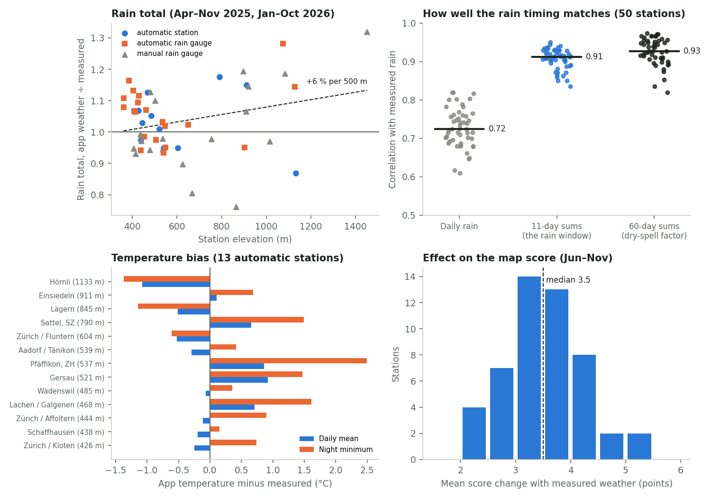

| What the score uses                   | App weather vs measured (median of the stations)                                                                                                                            |
| ------------------------------------- | --------------------------------------------------------------------------------------------------------------------------------------------------------------------------- |
| Rain total                            | ×1.03 (0.76–1.32); wetter higher up: +6 % per 500 m (Hoch-Ybrig ×1.32, Oberiberg ×1.28)                                                                                     |
| Daily rain                            | r = 0.73, mean error 2.1 mm/day; 86 % of days with ≥ 5 mm measured are found (≥ 2 mm); 11 % false wet days                                                                  |
| 11-day rain sums (the rain window)    | **r = 0.91**, ×1.03, mean error 8.7 mm                                                                                                                                      |
| 60-day rain sums (dry-spell factor)   | **r = 0.93**, ×1.01                                                                                                                                                         |
| Daily mean temperature                | bias −0.1 °C (−1.1 to +0.9), mean error 0.64 °C; 7-day means 0.52 °C                                                                                                        |
| Night minimum                         | **+0.7 °C too warm**; valley and lakeshore stations up to +2.5 °C (Pfäffikon ZH), hilltops too cold (Hörnli, Lägern)                                                        |
| Frost nights (≤ −1 °C) from September | 5 measured at the 13 stations, 2 in the app weather                                                                                                                         |
| **Effect on the map score**, Jun–Nov  | measured rain and temperature instead: **3.5 points** mean change (2.1–5.3), no overall bias (−0.2), 90 % of days within 11 points; the colour band changes on 15 % of days |

- **Matches:** the rain the score depends on (sums over 1–3 weeks and 60 days) is well reproduced at almost every station, at the station itself and at the app's weather point alike: the 3 km weather blocks lose almost nothing. Temperature means are within ±1 °C.
- **Doesn't match:** rain is overestimated at higher stations (~+20–30 % above 1,000 m; part of this is gauge undercatch, larger for snow in winter) and underestimated at a few hilly ZH stations (Allenwinden ×0.76, Bauma ×0.81). Night minimums in valleys are too warm, so the frost factor misses frost there.
- **Proposals (not applied):** (1) no change of weather source; (2) optionally, a valley frost correction: lower tmin by ~1.5 °C for squares in valley bottoms or near lakes before the frost factor, to be tested in autumn with the find log (low confidence, only 13 temperature stations and 5 frost nights); (3) no rain correction by elevation yet: the overestimate is partly gauge undercatch, and the score uses rain relative to species thresholds that were set with this same weather.

### Habitat: 30 random squares against the official layers

`validation/squares.ts`: 15 ZH and 15 SZ forest squares (fixed seed). Official layers: Arealstatistik 2013/18 (BFS, 100 points per square), the NFI forest mix raster (BAFU) re-read with independent code, the cantonal site type maps at 9 points, and GeoCover geology at the same points. Contact sheet with the official map of each square:

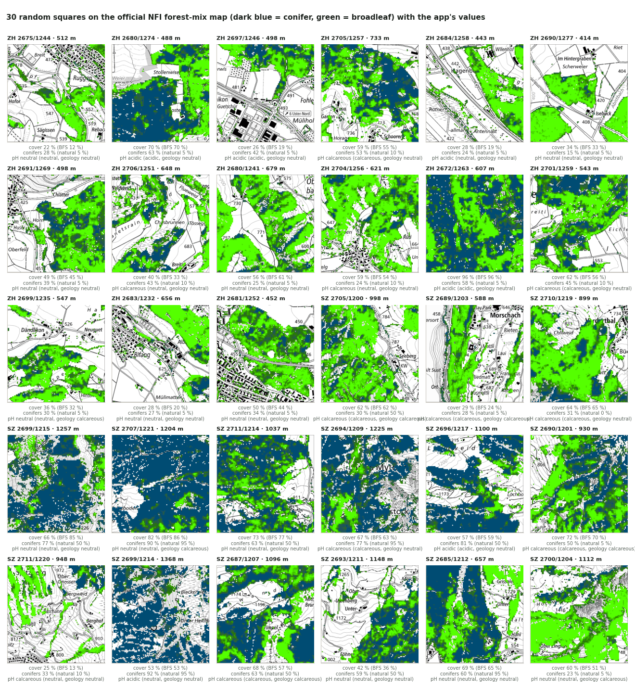

| Check                                | Result                                                                                                                                                                                                                                                                                    |
| ------------------------------------ | ----------------------------------------------------------------------------------------------------------------------------------------------------------------------------------------------------------------------------------------------------------------------------------------- |
| Tree cover vs Arealstatistik         | **r = 0.97**; app 3 points higher than the Arealstatistik forest classes (mean absolute difference 5), 0.3 points higher than forest + hedges/tree groups. The app counts every tree pixel, Arealstatistik forest only. Largest gaps: −19 (SZ 2699/1215, open forest above 1,200 m), +12. |
| Tree cover and conifer share re-read | identical in **30 of 30** squares: the grid build reads the raster correctly (including the legend: the raster holds the broadleaf share).                                                                                                                                                |
| Conifer share vs natural forest      | 20 squares are beech sites (natural conifers 5–10 %) with **15–63 % conifers today** (mean 36 %): planted spruce. The 10 fir/spruce sites: 69 % conifers today vs 68 % natural.                                                                                                           |
| pH class: site types, 9 vs 5 points  | same class in **25 of 30**; the 5 differences are mixed squares where the 9 points find a neutral majority.                                                                                                                                                                               |
| pH class: geology vs site types      | same class in only 14 of 30. In Zürich GeoCover gives "neutral" (moraine, molasse) for 14 of 15 squares: geology alone hardly separates soils there. It's only the fallback (60 squares, 4 %).                                                                                            |

- **Matches:** tree cover, conifer share and the site-type pH are read correctly and agree with the official layers.
- **Doesn't match / limits:** pH from 5 points is a coarse majority in mixed squares; geology is uninformative in Zürich. Today's conifer share is mostly planted spruce on beech sites, so the natural site type alone can't give the current trees (see the host-tree proposal below).
- **Proposals (not applied):** none for the grid build. Optionally use 9 instead of 5 site-type points (3 more requests per square, 5 of 30 squares would change class).

## Habitat with host trees (proposal, 2026-10-21)

Requested after Part C: replace each species' preference for a conifer share by specific host trees. Sources and tables: [DATA_SOURCES.md, "Tree species and host trees"](DATA_SOURCES.md#tree-species-and-host-trees-2026-10-21-used-since-the-host-tree-change).

- **Tree mix of each square:** the cantonal site type gives the natural main trees; the NFI conifer share (current stand) is split among them; conifers on beech sites count as planted spruce. (Measured tree species maps exist but are not open data, so they aren't used.)
- **Host preference per species:** SwissFungi's Swiss records per mycorrhizal partner tree, divided by each tree's share of the forest (NFI); literature for winter chanterelle; none for honey fungus and parasol (not mycorrhizal).
- **Host score** = Σ tree share × preference, capped at 1 (an average Swiss forest = 1; a square of poor hosts lower; floor 0.2). It replaces the conifer-share part of H; weights, pH, elevation and tree cover are unchanged. `validation/hosts.ts`.

| Species            | Record squares (ZH/SZ, precise) | AUC vs all forest: current → host trees | vs target group | SwissFungi 5 km squares (n) | Median H    | Squares with H ≥ 0.7 |
| ------------------ | ------------------------------- | --------------------------------------- | --------------- | --------------------------- | ----------- | -------------------- |
| Chanterelle        | 0                               | –                                       | –               | 0.61 → 0.59 (41)            | 0.88 → 0.86 | 97 → 90 %            |
| Porcini            | 4                               | 0.53 → 0.52                             | 0.50 → 0.51     | 0.50 → 0.50 (54)            | 0.94 → 0.93 | 100 → 99 %           |
| Winter chanterelle | 6                               | 0.59 → 0.62                             | 0.62 → 0.64     | 0.62 → 0.61 (40)            | 0.65 → 0.70 | 37 → 50 %            |
| Horn of plenty     | 4                               | 0.85 → 0.89                             | 0.79 → 0.84     | 0.58 → 0.55 (40)            | 0.83 → 0.88 | 73 → 87 %            |
| Bay bolete         | 8                               | 0.61 → 0.63                             | 0.54 → 0.57     | 0.59 → 0.59 (53)            | 0.87 → 0.87 | 97 → 94 %            |
| Hedgehog           | 2                               | 0.65 → 0.69                             | 0.53 → 0.60     | 0.50 → 0.49 (58)            | 0.97 → 0.97 | 100 → 100 %          |
| Honey fungus       | 32                              | 0.52 → 0.52                             | 0.51 → 0.51     | 0.53 → 0.53 (40)            | 1.00 → 1.00 | 100 → 100 %          |
| Parasol            | 19                              | 0.52 → 0.52                             | 0.47 → 0.47     | 0.52 → 0.52 (45)            | 1.00 → 1.00 | 97 → 97 %            |
| Morel              | 5                               | 0.57 → 0.60                             | 0.47 → 0.51     | 0.56 → 0.57 (48)            | 0.75 → 0.86 | 56 → 73 %            |

Habitat maps, current vs host trees: [chanterelle](validation/habitat-hosts-chanterelle.png), [porcini](validation/habitat-hosts-porcini.png), [winter chanterelle](validation/habitat-hosts-winter-chanterelle.png), [horn of plenty](validation/habitat-hosts-horn-of-plenty.png), [bay bolete](validation/habitat-hosts-bay-bolete.png), [hedgehog](validation/habitat-hosts-hedgehog.png), [honey fungus](validation/habitat-hosts-honey-fungus.png), [parasol](validation/habitat-hosts-parasol.png), [morel](validation/habitat-hosts-morel.png).

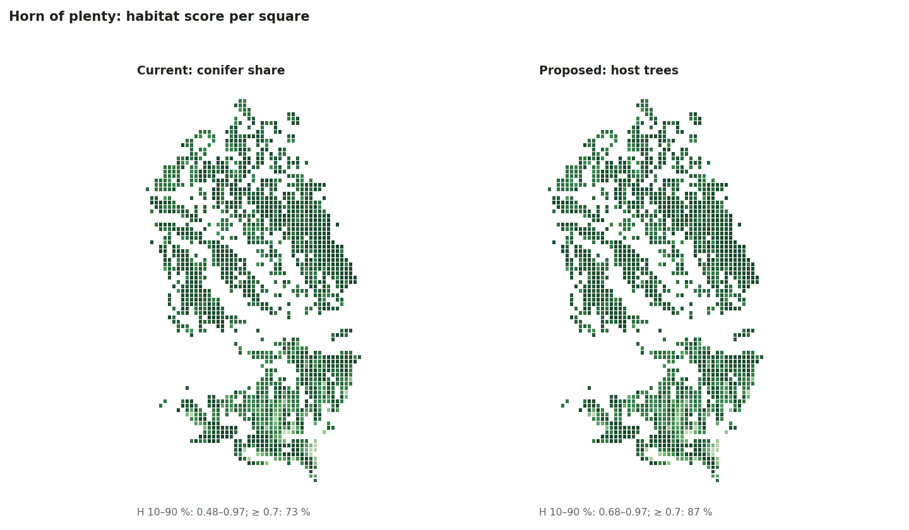

- **Matches:** on the precise records the host-tree version is slightly better for 5 of 6 testable species (+0.02 to +0.04), and the preferences are biologically sensible (beech, oak and fir for chanterelle and horn of plenty; pine for bay bolete; ash for morel; ash and maple poor for all mycorrhizal species).
- **But it can't be shown to be better:** the precise samples are 2–8 squares per species, and on the larger SwissFungi test (40–58 squares of 5 km, averaged over 25 km²) the two versions are equal within ±0.03 (chanterelle −0.02, horn of plenty −0.03). With 1 km squares and a tree mix partly estimated from the site type, the habitat part still barely separates find places.
- **What changes on the map:** horn of plenty and morel gain in fir-rich mountain squares (horn of plenty under conifers: 0.41 → 0.71 at Oberiberg; fir is a good partner in the SwissFungi data, while the current model only allows up to 40 % conifers); chanterelle loses a little in spruce-dominated squares (spruce 0.7); winter chanterelle gains in conifer squares.
- **Spots:** most spots change by less than 0.05; the largest changes are horn of plenty (+0.13 to +0.33 at the 7 conifer-rich spots in the Ybrig, Sattel and Alpthal areas) and morel (−0.10 to +0.30).

**Recommendation:** adopt the host-tree version as the better-founded model (Swiss partner data instead of a guessed conifer range, and the "why" panel can then name the host trees), but **with low confidence that it improves predictions**: the available tests can't tell the two apart. Its main weakness is the estimated tree mix (no open map of current tree species exists). **Applied on 2026-10-21** (approved): species.json has per-species host preferences instead of `conifer_pct`; the tree mix is computed from the site type and conifer share already in grid.json/habitat.json (details in SCORING.md).
